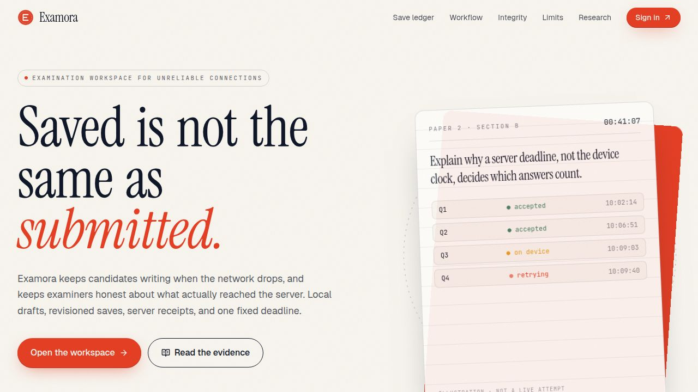

# Test evidence archive

- [Video-inspired delivery and QR admission verification](reports/video-delivery-2026-11-27.md)

This directory contains shareable evidence from development verification on
2026-11-27. It is documentation, not runtime application code.

## What is actually available

| Material | Repository status |
| --- | --- |
| Six workspace visual snapshots | Archived below as small JPEGs |
| Candidate recovery browser results | [Detailed report](reports/recovery-2026-11-27.md) |
| Sign-in browser follow-up | [Detailed report](reports/sign-in-2026-11-27.md) |
| Automated regression checks | [Commands and outcomes](reports/regression-checks.md) |
| Public Vercel deployment checks | [Read-only HTTP results](reports/live-smoke-2026-11-27.md) |
| Live candidate-to-published-result journey | [Workflow results and limitations](reports/live-workflow-2026-11-27.md) |
| Five screenshots returned by the browser tester | Retained as Replit observation images; no file export was exposed |
| Replit interactive test replay | Review in the original Replit testing session; not exported here |
| Downloadable video, Playwright trace or HAR from these runs | Not created by the recorded test setup |

**There are no MP4/WebM recordings in this directory.** Still images and written
reports are not substitutes for a continuous recording. No recording or replay
has been fabricated.

Replit documents reviewing recordings in its testing interface:
[App Testing](https://docs.replit.com/features/agent/app-testing).
That documentation does not provide a replay-file export workflow. The existing
tester context was also checked for video/trace files; none were available.

## Visual snapshots

These six images were available as workspace screenshot files and were visually
reviewed before inclusion. They are **visual snapshots**, not screenshots exported
from the recovery browser test. Some are historical, mid-animation captures and
do not represent the final settled page.

File integrity hashes are recorded in [SHA256SUMS](screenshots/SHA256SUMS).
From the repository root, check them with
`cd docs/evidence/screenshots && sha256sum -c SHA256SUMS`.

| Image | Description |
| --- | --- |
| [01 — Sign-in](screenshots/01-sign-in.jpg) | Historical sign-in screen; includes intentionally public fictional demo-account information |
| [02 — Mobile landing, entrance](screenshots/02-landing-mobile-entrance.jpg) | Historical mobile snapshot during entrance animation |
| [03 — Desktop landing, entrance](screenshots/03-landing-desktop-entrance.jpg) | Historical desktop snapshot during entrance animation |
| [04 — Mobile landing, settled](screenshots/04-landing-mobile.jpg) | Mobile public landing page |
| [05 — Research page](screenshots/05-research.jpg) | Historical research assessment; feature labels may predate later implementations |
| [06 — Desktop landing, settled](screenshots/06-landing-desktop.jpg) | Later desktop public landing page |

## Limits and privacy

- Verification used fictional development data, not real student records.
- No browser profiles, session cookies, tokens, private account passwords,
  authentication state, database connection strings, or raw network logs are
  included.
- The public fictional demo credential visible in the historical sign-in image
  is already intentionally documented in the application README. It is not a
  secret for a real-user deployment.
- The reports describe executed checks and explicitly identify coverage gaps.
  They do not certify the production deployment or completion of every PDF
  requirement.
- Large/raw test output belongs under ignored `generated-artifacts/`, not Git
  history. These small, curated documentation images are kept separate.
- Future exportable video should be recorded during a planned verification
  session and published through an appropriate large-file attachment/link rather
  than silently adding large binaries to Git. Review it for sensitive content
  before sharing.
